  

  <a href="https://github.com/jxfriis?tab=repositories">Explore my work ↗</a>
  &nbsp;&nbsp; / &nbsp;&nbsp;
  <a href="https://getflowline.site">Flowline ↗</a>
  &nbsp;&nbsp; / &nbsp;&nbsp;
  <a href="https://codexbuddy.vercel.app/">CodexBuddy ↗</a>

 

### Small details. Real projects.

I build apps, tools, and experiments—from desktop companions to interactive web playgrounds.
This is where the ideas turn into something you can use.

 

### Selected work

| Project | The idea |
| :--- | :--- |
| **[Flowline ↗](https://getflowline.site)** | A Windows app. [Releases & downloads](https://github.com/jxfriis/flowline-releases). |
| **[CodexBuddy ↗](https://github.com/jxfriis/codexbuddy-releases)** | A compact Windows companion that keeps Codex usage and reset countdowns in view. |
| **[OLIVER.EXE ↗](https://github.com/jxfriis/oliver-exe)** | An interactive playground with mini-games, character customization, and a 16-bit mode. |

 

### In the toolkit

`TypeScript` &nbsp; `React` &nbsp; `Next.js` &nbsp; `Vite` &nbsp; `Tailwind CSS`

 

---

LESS NOISE. MORE BUILDING.

