<a href="https://github.com/jxfriis?tab=repositories">Browse repositories</a>
&nbsp; · &nbsp;
<a href="https://getflowline.site">Download Flowline</a>
&nbsp; · &nbsp;
<a href="https://codexbuddy.vercel.app/">Get CodexBuddy</a>

 

 

