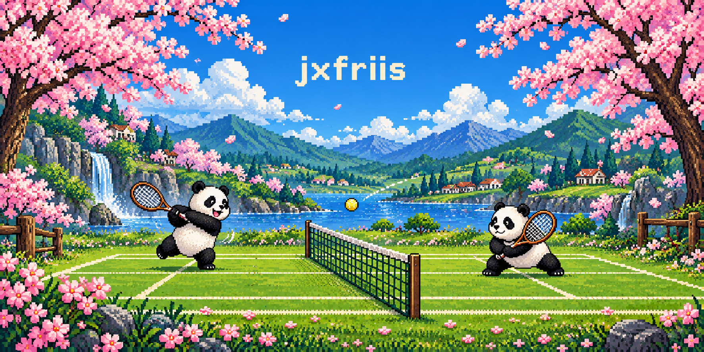
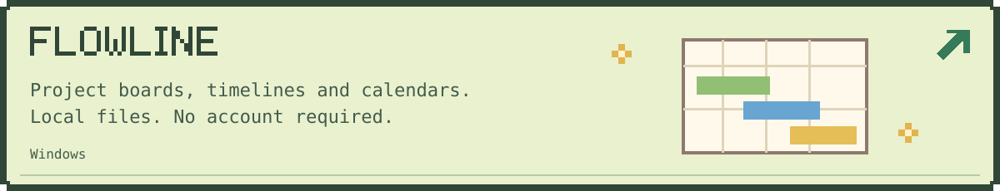
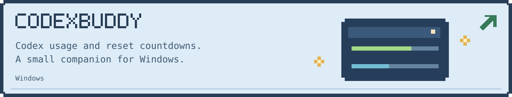
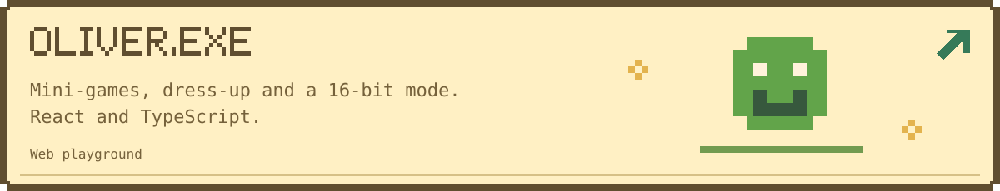

<a href="https://github.com/jxfriis?tab=repositories">Browse repositories</a>
&nbsp; · &nbsp;
<a href="https://getflowline.site">Flowline</a>
&nbsp; · &nbsp;
<a href="https://codexbuddy.vercel.app/">CodexBuddy</a>
&nbsp; · &nbsp;
<a href="https://jxfriis.github.io/oliver-exe/">OLIVER.EXE</a>

